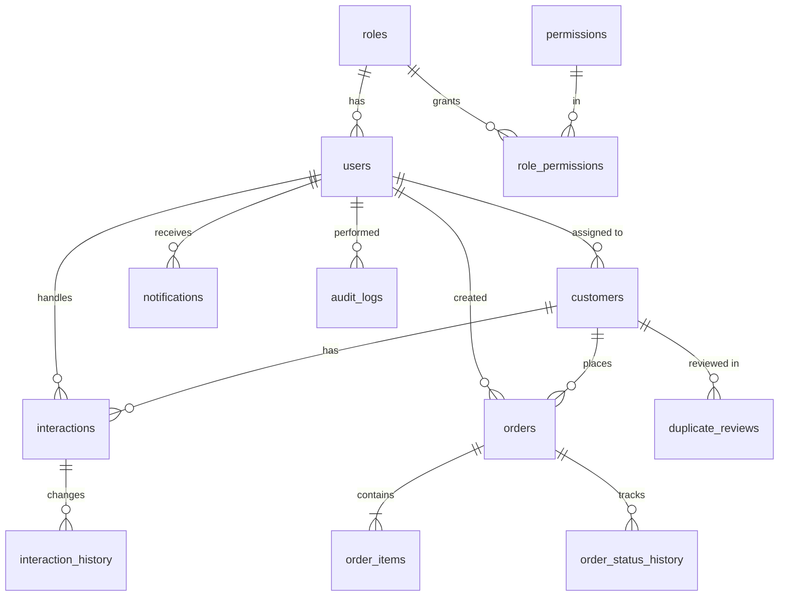

# Veltrix database design

Database `veltrix_db`, InnoDB, utf8mb4. Works on MySQL 5.7+ and MariaDB 10.4+ (the version XAMPP ships).
VS Code shows the diagram below if you install the "Markdown Preview Mermaid Support" extension. GitHub renders it automatically.

## Entity-relationship diagram

## Tables

| Table | Purpose | Key rules |
|---|---|---|
| `roles` | Administrator, Manager, Employee | Unique `code` |
| `permissions` | Named actions such as `customers.archive` | Unique `code` |
| `role_permissions` | Which role holds which permission | Composite primary key; cascades with role or permission |
| `users` | Staff accounts | Unique email; bcrypt hash only; deactivate with `is_active`, never delete |
| `customers` | Customer profiles | Unique `customer_code`; `email_normalized` and `phone_normalized` for matching; `version` for optimistic locking; archived instead of deleted |
| `interactions` | Calls, emails, meetings, chats, complaints, follow-ups | FK to customer is `RESTRICT`; indexed by follow-up date |
| `interaction_history` | What changed on an interaction, by whom | Insert only |
| `orders` | Order header, totals and statuses | FK to customer is `RESTRICT`; `DECIMAL(12,2)` money; unique `idempotency_key`; `version` |
| `order_items` | Line items | Removed only together with their order (`CASCADE`) |
| `order_status_history` | Every status or payment change | Insert only; `kind` is `status` or `payment` |
| `notifications` | In-app alerts per user | `dedupe_key` stops duplicate reminders |
| `audit_logs` | Who did what, when, with before and after values | Insert only; optional trigger file blocks UPDATE and DELETE |
| `duplicate_reviews` | A manager's decision on a flagged pair | `customer_a_id` is always the smaller id; unique pair |
| `system_settings` | Business name, currency, reminder window | Key and value |
| `error_logs` | Sanitized record of failed requests | No stack traces, no personal data |

## Important relationships and rules

- **A customer with history can never be deleted.** `interactions.customer_id` and `orders.customer_id` use `ON DELETE RESTRICT`. Customers are archived instead.
- **An order can never be detached from its customer.** `orders.customer_id` is `NOT NULL` with a foreign key, and every order write runs in a transaction.
- **One active customer per email, enforced by the database.** `customers.email_active` is a generated column equal to `email_normalized` unless the customer is archived. Its unique index rejects a second active customer with the same email, even if the application check is bypassed. Archiving or merging a profile frees the email.
- **Shared phones are allowed.** `phone_normalized` is indexed but not unique, because family members share phones. The application flags a shared phone only when the name also matches.
- **Order items live and die with their order.** `order_items.order_id` uses `CASCADE`, but orders themselves are never deleted, only cancelled.
- **Users are never deleted.** Audit logs, interactions, orders and history refer to them, so accounts are deactivated.
- **Permissions are data.** Edit `role_permissions` to change what a role may do. The API reads permissions from the database on every request.

## Money and time

- Money is `DECIMAL(12,2)`. The API calculates totals in whole cents and writes them back as decimals.
- Timestamps are stored in UTC (`DATETIME`). The API sets the connection time zone to `+00:00` and returns ISO 8601 strings. The browser shows them in the viewer's local time.
